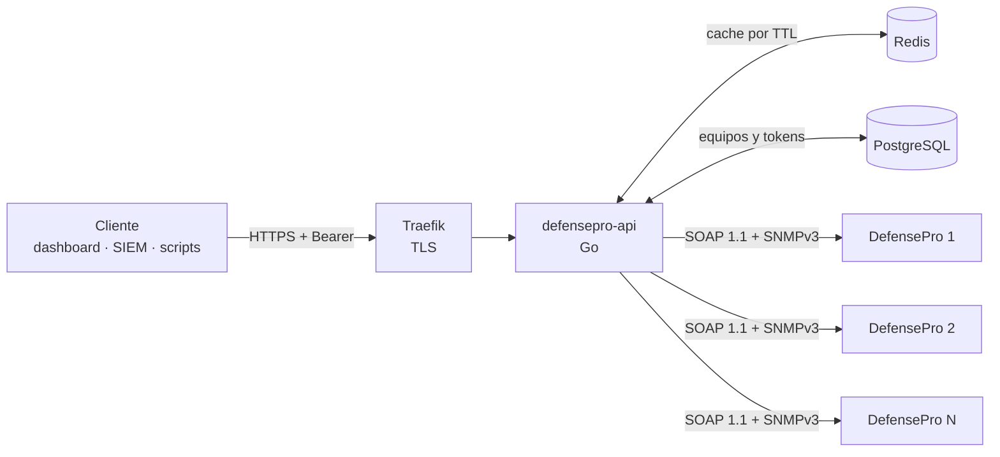

<div align="center">

# DefensePro API

**API REST para monitorear equipos Radware DefensePro desde un único punto.**

Consulta varios DefensePro en paralelo a través de su API SOAP y SNMPv3, y entrega JSON limpio: tráfico en tiempo real por política y protocolo, ataques, políticas, protecciones, salud y auditoría.

[](https://go.dev/)
[](https://docs.docker.com/compose/)
[](https://www.postgresql.org/)
[](https://redis.io/)
[](https://traefik.io/)
[](https://www.radware.com/products/defensepro/)

[Características](#características) •
[Arquitectura](#arquitectura) •
[Inicio rápido](#inicio-rápido) •
[API](#referencia-de-la-api) •
[Administración](#administración) •
[Troubleshooting](#troubleshooting)

</div>

---

## Características

- **Multi-equipo**: consulta todos los DefensePro registrados en paralelo; cada elemento de la respuesta indica su equipo de origen y los que fallan se reportan aparte, sin romper la respuesta.
- **Visibilidad de seguridad**: log de ataques con filtros por riesgo, categoría, acción, tipo y política, más un resumen agregado listo para dashboards.
- **Estado operativo**: CPU por engine, RAM, disco, tráfico, session table, temperaturas, ventiladores y fuentes.
- **Inventario**: versiones, licencias, políticas con sus perfiles, interfaces, rutas y estado de cada módulo de protección.
- **Cuidado con el equipo**: cache en Redis por tipo de dato, límite configurable de llamadas SOAP simultáneas y detección temprana de equipos caídos para no acumular timeouts.
- **Tolerante a diferencias entre modelos**: si un equipo no soporta una función (p. ej. ventiladores en un DefensePro virtual), ese dato queda vacío y el resto se entrega igual.
- **Tráfico en tiempo real por SNMPv3**: recibido y descartado por política y protocolo (las 33 políticas en una consulta), por puerto, conexiones y sesiones por engine, triggers de SYN protection y salud del equipo.
- **Segura por defecto**: **sólo lectura garantizada** (candados en los clientes SOAP y SNMP), nunca lee secretos, autenticación Bearer con tokens hasheados, HTTPS vía Traefik y puerto expuesto sólo en loopback.
- **Diagnóstico integrado**: CLI de administración para probar la conexión SOAP y ver el XML crudo de cualquier operación.

---

## Arquitectura



La API usa dos fuentes del equipo:

- **SOAP 1.1 RPC/encoded** (`https://<equipo>/soap`, Basic Auth): configuración, políticas, perfiles, log de ataques, auditoría.
- **SNMPv3** (UDP 161): tráfico en tiempo real, sesiones, salud. Es más liviano y no tiene el límite de salida del CLI.

Cada equipo tiene una cola propia: por defecto una llamada a la vez con 100 ms entre llamadas, compartida por SOAP y SNMP. Las respuestas se cachean en Redis.

| Componente | Rol |
|---|---|
| `defensepro-api` | Servidor HTTP en Go: autenticación, agregación multi-equipo y cliente SOAP |
| PostgreSQL | Equipos registrados y tokens de acceso |
| Redis | Cache de respuestas SOAP (de 5 s a 10 min según el dato) |
| Traefik | Terminación TLS en el puerto público |

---

## Requisitos

| Dónde | Qué |
|---|---|
| Host | Docker 20.10+ con Docker Compose, `openssl` y, opcionalmente, `curl` + `jq` |
| DefensePro | API SOAP y HTTPS habilitados, un usuario de gestión de sólo lectura y, para los endpoints de tiempo real, un usuario SNMPv3 (idealmente SHA/AES) |

Para habilitar la API SOAP, una sola vez desde el CLI de cada equipo:

```
manage web-services status set enable
manage secure-web status set enable
```

---

## Inicio rápido

```bash
# 1. Configuración
cp .env.example .env            # cambia POSTGRES_PASSWORD y REDIS_PASSWORD
./scripts/gen-certs.sh          # certificado TLS autofirmado

# 2. Levantar los servicios
docker compose up -d --build

# 3. Registrar un equipo y comprobar la conexión SOAP
alias admin='docker compose exec app defensepro-admin'
admin add-device DP-CORE-1 https://10.10.0.21 apiuser 'Password1.'
admin test-device DP-CORE-1

# 4. (Opcional, recomendado) SNMPv3 para el tráfico en tiempo real
admin set-snmp DP-CORE-1 snmp-ro SHA 'ClaveAuth' AES 'ClavePriv'
admin test-snmp DP-CORE-1

# 5. Emitir un token (se muestra una sola vez)
admin create-token mi-cliente

# 6. Aplicar los cambios y consultar
docker compose restart app
curl -k -H "Authorization: Bearer <token>" https://127.0.0.1:5687/api/v1/system | jq
```

Salida esperada de `test-device`:

```
endpoint: https://10.10.0.21/soap
  OK   Device.SystemParameters.get_DeviceName        DP-CORE-1
  OK   Device.Information.get_Platform               DefensePro
  OK   Device.Information.get_SoftwareVersion        8.34.2.0
  OK   Device.Utilization.get_ResourceUtilization    23
```

> [!NOTE]
> El servidor recarga la lista de equipos cada 5 minutos. `docker compose restart app` aplica los cambios al instante.

---

## Referencia de la API

Todos los endpoints `/api/v1/*` requieren el header `Authorization: Bearer <token>` y aceptan `?device=` (CSV) para consultar sólo ciertos equipos. Sin ese parámetro se consultan todos los habilitados.

### Endpoints

| Método | Endpoint | Descripción | Cache |
|---|---|---|---|
| `GET` | `/health` | Estado del proceso (sin auth) | — |
| `GET` | `/health/deep` | Ping SOAP a cada equipo (sin auth) | — |
| `GET` | `/api/v1/traffic/policies` | **SNMP** · Tráfico en tiempo real por política y protocolo (TCP, UDP, ICMP, OTHER, SCTP, IGMP): conexiones nuevas, pps y bytes/s recibidos y descartados, más totales. `?policy=`, `?include_idle=true` | 10 s |
| `GET` | `/api/v1/traffic/ports` | **SNMP** · Por puerto físico: pps, Mbps, descartes y errores de entrada/salida, y por protocolo recibido, descartado y excluido. `?include_idle=true` | 10 s |
| `GET` | `/api/v1/sessions` | **SNMP** · Conexiones concurrentes TCP/UDP, entradas de la session table y uso por engine | 10 s |
| `GET` | `/api/v1/syn-triggers` | **SNMP** · Triggers activos de SYN protection: IP y puerto atacados, SYN y requests por segundo, descartadas | 10 s |
| `GET` | `/api/v1/health` | **SNMP** · Salud: CPU (controlador y engines), acelerador, RAM, disco, temperaturas, fuentes, HA, reloj del equipo y su desfase, tablas internas, feed ERT y estado de cada servidor syslog (alcanzable, logs pendientes) | 10 s |
| `GET` | `/api/v1/info` | **SNMP** · Identidad: nombre, serie, versión, tipo, puertos, throughput y mitigación licenciados, cores, MAC | 10 min |
| `GET` | `/api/v1/system` | Nombre, ubicación, uptime, plataforma, versiones de software, hardware, módulo de seguridad y base de firmas; MAC, RAM, modo de mitigación y operación, estado HA e imágenes instaladas | 10 min ¹ |
| `GET` | `/api/v1/licenses` | License ID, licencia de throughput, capacidad de mitigación y estado del feed ERT (la clave de licencia no se publica) | 10 min |
| `GET` | `/api/v1/monitoring` | CPU global y por engine, RAM, disco, tráfico del último segundo y pico, entradas de la session table | 10 s |
| `GET` | `/api/v1/hardware` | Temperatura de CPUs, ventiladores y fuentes de poder | 10 s |
| `GET` | `/api/v1/interfaces` | Interfaces L2 con estado y contadores, puertos físicos y tráfico por puerto | 10 s |
| `GET` | `/api/v1/network` | Interfaces IP (IPv4/IPv6) y tabla de rutas | 1 min |
| `GET` | `/api/v1/policies` | Políticas de protección con perfiles, utilización y recursos de HW. Filtro `?policy=` | 1 min |
| `GET` | `/api/v1/attacks` | Log de seguridad con filtros y resumen agregado | 5 s |
| `GET` | `/api/v1/suspended` | Orígenes suspendidos o bloqueados | 10 s |
| `GET` | `/api/v1/protections` | Estado global de cada módulo de protección y perfiles BDoS | 1 min |
| `GET` | `/api/v1/profiles` | Perfiles de protección por módulo (BDoS, DNS, SYN, HTTPS flood, out-of-state, anti-scanning, traffic filters, geo, ERT, QDoS, PPS, connection limit). Filtro `?type=` | 1 min |
| `GET` | `/api/v1/behavioral` | Behavioral protections: estado y aprendizaje de BDoS y DNS, sus perfiles, tráfico de puertos excluidos por política (bps/pps promedio y pico) y ataques behavioral | 5 s – 1 min |
| `GET` | `/api/v1/networks` | Clases de red (nombre → IPs/máscaras) que usan las políticas como origen o destino. Filtro `?name=` | 1 min |
| `GET` | `/api/v1/blocklists` | Listas de bloqueo (incluidas las dinámicas con su expiración) y de permitidos | 10 s – 1 min |
| `GET` | `/api/v1/geo` | Reglas geo dinámicas y temporales por política, países asociados a cada perfil e IPs excluidas | 10 s – 1 min |
| `GET` | `/api/v1/capacity` | Uso vs. capacidad de la session table, suspend table y tablas de autenticación TCP/HTTP; límites de políticas y tablas internas | 10 s – 10 min |
| `GET` | `/api/v1/management` | Auditoría de gestión: HTTP/HTTPS/SSH/Telnet y sus puertos, cifrados débiles, método de autenticación, NTP, DNS y syslog | 1 min |
| `GET` | `/api/v1/behavioral/traffic` | Métricas en tiempo real de una política (como BDoS/DNS Traffic Monitoring del Vision): baseline, tráfico actual, descartado y legítimo de BDoS por protocolo (entrada/salida, IPv4/IPv6, estado de aprendizaje y anomalía) y de DNS por tipo de consulta. `?policy=` obligatorio | 10 s |
| `GET` | `/api/v1/analytics` | Network analytics: tráfico total y por puerto, utilización por política y agregados del log (top ataques, orígenes, destinos, puertos y políticas) | 5 s – 10 s |

¹ Uptime, fecha y hora se leen siempre en vivo.

### Filtros de `/api/v1/attacks`

Todos aceptan valores separados por coma y no distinguen mayúsculas.

| Parámetro | Valores | Ejemplo |
|---|---|---|
| `risk` | `info`, `low`, `medium`, `high` | `risk=high,medium` |
| `category` | `dos`, `behavioral-doS`, `syn-flood`, `http-flood`, `dns-protection`, `scanning`, `intrusion`, `anomalies`, `traffic-filters`, `acl`, ... | `category=syn-flood` |
| `action` | `drop`, `report-only`, `proxy`, `rst-src`, `rst-dst`, `rst-bi`, `quarantine`, ... | `action=drop` |
| `type` | `started`, `ongoing`, `terminated`, `occur`, `sampled` | `type=started,ongoing` |
| `policy` | Nombre de la política de protección | `policy=Web` |
| `limit` | Entradas por equipo, más recientes primero. Default `500`, `0` = sin límite, máximo `10000` | `limit=50` |

El `summary` se calcula sobre todo lo que pasa el filtro, antes de aplicar `limit`: `summary.total` cuenta las coincidencias y `summary.returned` las entradas devueltas.

### Parámetros de `/profiles`, `/behavioral` y `/analytics`

| Endpoint | Parámetro | Descripción |
|---|---|---|
| `/profiles` | `type` | Módulos a consultar (CSV): `bdos`, `dns`, `syn`, `https`, `oos`, `antiscanning`, `trafficfilters`, `geo`, `ert`, `qdos`, `pps`, `connectionlimit`. Sin el parámetro se consultan todos (12 llamadas SOAP); los módulos no pedidos no aparecen en la respuesta |
| `/behavioral` | `bypass` | `true` agrega la tabla de bypass de BDoS |
| `/behavioral` | `policy` | Limita todo a esas políticas: sus perfiles BDoS/DNS, su tráfico de puertos excluidos y sus ataques. `policies` lista qué perfiles tiene asignados cada política |
| `/behavioral` | filtros de `/attacks` | Se aplican a los ataques behavioral (`behavioral-doS` y `dns-protection` por defecto). `limit` default `50` |
| `/analytics` | filtros de `/attacks` | Restringen los agregados (p. ej. `?policy=Pol_WWW`). `limit` no aplica; `policy` también filtra la utilización por política |
| `/analytics` | `top` | Cantidad de elementos en cada ranking. Default `10`, máximo `100` |

> [!NOTE]
> Las gráficas de baseline vs. tráfico real por protocolo que muestra APSolute Vision no se exponen por la API SOAP del equipo, así que no están en `/behavioral`. `excludedPortsTraffic` corresponde al tráfico de los puertos UDP excluidos de BDoS.

### Ejemplos

```bash
export TOKEN=<tu-token>
export API=https://127.0.0.1:5687

# Ataques de riesgo alto o medio que siguen activos
curl -k -H "Authorization: Bearer $TOKEN" \
  "$API/api/v1/attacks?risk=high,medium&type=started,ongoing&limit=50" | jq

# Utilización de un solo equipo
curl -k -H "Authorization: Bearer $TOKEN" "$API/api/v1/monitoring?device=DP-CORE-1" | jq

# Una política concreta
curl -k -H "Authorization: Bearer $TOKEN" "$API/api/v1/policies?policy=Web" | jq

# Perfiles BDoS y DNS
curl -k -H "Authorization: Bearer $TOKEN" "$API/api/v1/profiles?type=bdos,dns" | jq

# Behavioral protections con los ataques en curso
curl -k -H "Authorization: Bearer $TOKEN" "$API/api/v1/behavioral?type=started,ongoing" | jq

# Qué IPs hay detrás de la clase de red "DNS" que usa Pol_DNS
curl -k -H "Authorization: Bearer $TOKEN" "$API/api/v1/networks?name=DNS" | jq

# ¿Alguna tabla cerca de llenarse?
curl -k -H "Authorization: Bearer $TOKEN" "$API/api/v1/capacity" | jq

# Analytics: top 5 de una política
curl -k -H "Authorization: Bearer $TOKEN" "$API/api/v1/analytics?policy=Pol_WWW&top=5" | jq
```

### Formato de respuesta

Cada endpoint devuelve un elemento por equipo en `data`, con su identidad, la hora de lectura (`collectedAt`, RFC3339 UTC, útil como `@timestamp`) y, si alguna sub-lectura falló, la lista `errors` dentro del elemento: ese dato quedó vacío y **no** debe tomarse como 0 real. Los equipos que no respondieron aparecen en el `errors` de nivel superior.

> [!IMPORTANT]
> Los valores de `/traffic/*` son el **promedio por segundo de los últimos 15 s** que calcula el equipo (gauges, aunque el MIB los declare `Counter64`). En ELK se grafican tal cual: no hay que calcular deltas. Están en **bytes**, no bits (`receivedMbps` ya viene convertido).

```json
{
  "data": [
    {
      "deviceName": "DP-CORE-1",
      "deviceUrl": "https://10.10.0.21",
      "deviceIp": "10.10.0.21",
      "summary": {
        "total": 3,
        "returned": 3,
        "byRisk": { "high": 2, "medium": 1 },
        "byCategory": { "syn-flood": 2, "dos": 1 },
        "byAction": { "drop": 3 },
        "byType": { "ongoing": 2, "started": 1 }
      },
      "attacks": [
        {
          "index": 18234,
          "name": "SYN Flood",
          "type": "ongoing",
          "category": "syn-flood",
          "risk": "high",
          "action": "drop",
          "policyName": "Web",
          "destinationAddress": "10.20.0.10",
          "destinationPort": 443
        }
      ]
    }
  ],
  "errors": [
    { "device": "DP-CORE-2", "error": "Device.Utilization.get_ResourceUtilization: auth 401: credenciales rechazadas por el equipo" }
  ]
}
```

### Códigos de estado

| Código | Significado |
|---|---|
| `200` | Al menos un equipo respondió (revisa `errors` para los demás) |
| `400` | Parámetro inválido (p. ej. `limit` fuera de rango) |
| `401` | Token ausente, inválido o revocado |
| `404` | `?device=` nombra un equipo inexistente o deshabilitado |
| `502` | Ningún equipo respondió |

---

## Configuración

Variables de entorno, definidas en `.env` (ver [`.env.example`](.env.example)):

| Variable | Default | Descripción |
|---|---|---|
| `POSTGRES_USER` / `POSTGRES_PASSWORD` / `POSTGRES_DB` | `defensepro` | Credenciales de la base interna |
| `REDIS_PASSWORD` | *(vacío)* | Password de Redis |
| `LOG_LEVEL` | `info` | `debug`, `info`, `warn`, `error`. En `debug` se registra cada llamada SOAP |
| `LOG_FORMAT` | `text` | `text` o `json` (para ingesta en SIEM) |
| `ALLOWED_ORIGINS` | `*` | Orígenes CORS permitidos (CSV) |
| `DEVICE_MAX_CONCURRENCY` | `1` | Llamadas simultáneas (SOAP y SNMP) por equipo |
| `DEVICE_MIN_CALL_GAP` | `100ms` | Pausa mínima entre llamadas al mismo equipo |
| `DEVICE_BUSY_CPU_PCT` | `85` | Si la CPU del equipo supera este %, las consultas pesadas (`attacks`, `analytics`, `behavioral`, `behavioral/traffic`, `profiles`, `management`) se omiten sin tocarlo. `0` desactiva |
| `PUBLIC_HTTPS_PORT` | `5687` | Puerto público HTTPS de Traefik |
| `AUTH_DISABLED` | *(vacío)* | `true` desactiva la autenticación. Sólo para desarrollo |

Variables usadas fuera de Docker Compose: `SERVER_HOST` (`127.0.0.1`), `SERVER_PORT` (`5687`), `DATABASE_URL`, `REDIS_ADDR` (`localhost:6379`) y `REDIS_DB` (`0`).

### Exponer la API a la red

Por defecto Traefik sólo escucha en `127.0.0.1`. Para publicarla en la LAN, ajusta `docker-compose.yml`:

```yaml
ports:
  - "${PUBLIC_HTTPS_PORT:-5687}:5687"
```

Para producción, reemplaza `traefik/certs/cert.pem` y `key.pem` por un certificado emitido por una CA de confianza.

---

## Administración

El CLI `defensepro-admin` viene incluido en la imagen:

```bash
alias admin='docker compose exec app defensepro-admin'
```

| Comando | Descripción |
|---|---|
| `add-device <name> <url> <user> <pass>` | Registra un DefensePro |
| `list-devices` | Lista los equipos registrados |
| `enable-device <name>` / `disable-device <name>` | Activa o pausa un equipo sin borrarlo |
| `remove-device <name>` | Elimina un equipo |
| `test-device <name>` | Prueba la conexión SOAP con el equipo |
| `cli <name> "<comando>"` | Ejecuta un comando CLI en el equipo vía SOAP (sólo diagnóstico; la API HTTP no lo expone) |
| `soap-call <name> <servicio> <operación>` | Muestra el XML crudo de una operación SOAP de lectura |
| `cli <name> "<comando>"` | Ejecuta uno de los comandos CLI de lectura permitidos |
| `set-snmp <name> <user> <auth> <auth-pass> <priv> <priv-pass> [puerto]` | Configura SNMPv3 (auth `MD5`/`SHA`/`SHA256`...; priv `DES`/`AES`/`AES256`.../`NONE`) |
| `clear-snmp <name>` | Quita la configuración SNMP |
| `test-snmp <name>` | Prueba SNMP con el equipo |
| `snmp-walk <name> <oid>` | Walk de diagnóstico, sólo sobre ramas permitidas |
| `snmp-allowlist` | Lista las ramas SNMP permitidas |
| `create-token <name>` | Emite un token de acceso (se muestra una sola vez) |
| `list-tokens` | Lista los tokens (id, nombre, creación, último uso, estado) |
| `revoke-token <id>` | Revoca un token |

`soap-call` permite inspeccionar cualquier operación de los WSDL de DefensePro, incluso las que la API no expone:

```bash
admin soap-call DP-CORE-1 Device.Information get_RamSize
admin soap-call DP-CORE-1 Security.Reporting getAll_Log
```

### Operación con Docker

```bash
docker compose logs -f app          # logs en vivo
docker compose restart app          # reiniciar la API
docker compose up -d --build app    # reconstruir tras cambios de código
docker compose down                 # detener (conserva los datos)
docker compose down -v              # detener y BORRAR equipos y tokens
```

### Instalación sin Docker

`install-defensepro-api.sh` instala la API como servicio systemd en `/opt/defensepro-api`. Requiere PostgreSQL y Redis accesibles.

```bash
go build -o defensepro-api ./cmd/server
go build -o defensepro-admin ./cmd/admin
sudo ./install-defensepro-api.sh

# el CLI necesita las mismas variables que el servicio
set -a; . /opt/defensepro-api/.env; set +a
/opt/defensepro-api/defensepro-admin add-device DP-CORE-1 https://10.10.0.21 apiuser 'Password1.'
```

---

## Troubleshooting

<details>
<summary><b><code>test-device</code> falla en todas las operaciones</b></summary>

| Síntoma | Causa probable | Solución |
|---|---|---|
| `status 404` o HTML en la respuesta | API SOAP deshabilitada | `manage web-services status set enable` |
| `connection refused` o timeout | HTTPS deshabilitado o equipo inalcanzable | `manage secure-web status set enable`; revisa ACL de gestión y firewall |
| `auth 401` | Credenciales incorrectas | Vuelve a registrar el equipo con el usuario correcto |

</details>

<details>
<summary><b>Algunos campos aparecen vacíos o en cero</b></summary>

Es esperado cuando el modelo no soporta esa función: el equipo responde con un SOAP Fault y ese dato se omite. Con `LOG_LEVEL=debug` verás `dato no soportado por el equipo op=...`. Para ver la respuesta exacta usa `admin soap-call <name> <servicio> <operación>`.

</details>

<details>
<summary><b>El DefensePro muestra carga alta de gestión</b></summary>

Baja `DEVICE_MAX_CONCURRENCY` en `.env` (p. ej. `2`) y aplica con `docker compose up -d`. Cada endpoint ejecuta entre 1 y 19 operaciones SOAP por equipo; la cache de Redis evita repetirlas cuando varios clientes consultan a la vez.

</details>

<details>
<summary><b><code>/health/deep</code> devuelve <code>total: 0</code></b></summary>

La API aún no recargó la lista de equipos. Ejecuta `docker compose restart app`.

</details>

<details>
<summary><b>Error de certificado al usar curl</b></summary>

El certificado generado es autofirmado: usa `curl -k` o reemplaza `traefik/certs/*.pem` por uno de una CA de confianza.

</details>

---

## Mapeo endpoint → operaciones SOAP

<details>
<summary>Ver qué operaciones de los WSDL usa cada endpoint</summary>

| Endpoint | Servicios y operaciones |
|---|---|
| `system` | `Device.SystemParameters`: get_DeviceName, Description, Location, Contact, SystemUpTime, Date, Time · `Device.Information`: get_Platform, SoftwareVersion, BuildNumber, rdwrDPVersion, SysBaseMACAddress, RamSize · `Device.Mitigation`: get_Device · `Security.Operation`: get_Device · `Device.HighAvailability`: get_haProtectionState · `Security.Version`: get_SecurityModuleVersion · `Security.AttackDB`: get_Version · `Management.VersionControl`: getAll_SoftwareVersion |
| `licenses` | `Management.LicenseAdmin`: get_LicenseId, TplLicense, TplLicenseId, TplLicenseMethod, TplLicenseIP · `Device.Information`: get_DeviceAttackMitigation, DeviceThroughput · `Security.ErtAttackersFeedStatus`: get_Status |
| `monitoring` | `Device.Utilization`: get_ResourceUtilization, Last5SecondAverageUtilization, Last60SecondsUtilzation, rsSysUtilEnginesCpuMean, SysUtilRAM\*, SysUtilDisk\* · `Device.Statistics`: get_TotalLastSecMbits · `Device.HardwareInfo`: get_TotalLastSecPeak, getAll_EngineResource · `Device.SessionTable`: get_UsedEntriesNumber |
| `hardware` | `Device.HardwareInfo`: getAll_CpuTemperature, getAll_SystemFans, get_DualPsuStatus |
| `interfaces` | `Networking.Interfaces`: getAll_L2Interface, getAll_PhysicalInterface · `Device.Statistics`: getAll_PortLastSec |
| `network` | `Networking.InterfacesNG`: getAll_IpInterface · `Networking.StaticRouting`: getAll_Route |
| `policies` | `Security.Policy`: getAll_Policy, getAll_PoliciesResources, get_TotalPolicyNum, HwEntriesUtil, SubPolicyUtil, UpdatePoliciesRequired, UpdatePoliciesInProgress · `Security.PolicyUtil`: getAll_PolicyUtil |
| `attacks` | `Security.Reporting`: getAll_Log |
| `suspended` | `Security.SuspendTable`: getAll_NewerSuspend |
| `profiles` | `Security.BehavioralDoS` getAll_Profiles · `Security.DnsProtection` getAll_DnsProtectionProfile · `Security.SynProtection` getAll_rsIDSSynProfilesParamsEntry · `Security.HTTPSFloodProtection` getAll_HttpsFloodProfileEntry · `Security.OutOfState` getAll_Profile · `Security.AntiScanning` getAll_AntiScanningProfiles · `Security.TrafficFilter` getAll_TrafficFilterProfile · `Security.GeoProfiles` getAll_GeoProfileEntry · `Security.ErtAttackersFeedProtection` getAll_ErtAttackersFeedProfileEntry · `Security.QdosProfiles` getAll_QdosProfileEntry · `Security.PpsRateLimit` getAll_rsPpsRateLimitProfile · `Security.ConnectionLimit` getAll_Profile |
| `behavioral` | `Security.BehavioralDoS`: get_Status, LearningResponsePeriod, overBlockingStatus, SamplingStatus, getAll_Profiles, getAll_rsNetFloodBypassEntry · `Security.DnsProtection`: get_DnsProtectionGlobalStatus, DnsProtectionLearningResponsePeriod, getAll_DnsProtectionProfile · `Security.bdosExcludedStatistics`: getAll_rsBdosExcludedStatisticsTableEntry · `Security.Reporting`: getAll_Log |
| `networks` | `Classes.Networks`: getAll_ActiveNetwork (o getAll_Network si la activa está vacía) |
| `blocklists` | `Security.AccessLists`: getAll_BlackList, getAll_WhiteList |
| `geo` | `Security.GeoPolicyDynamicRule` getAll_GeoPolicyDynamicRule · `Security.GeoPolicyTemporaryRule` getAll_GeoPolicyTemporaryRule · `Security.GeoAssocCountries` getAll_GeoAssocCountriesEntry · `Security.GeoExcludedIPList` getAll_GeoExcludedIPListEntry |
| `capacity` | `Device.SessionTable` get_UsedEntriesNumber · `Device.Tuning` get_SessionsCurrent · `Security.SuspendTable` get_SuspendTableEntries · `Security.AuthenticationTables` get_Tcp/HttpAuthenticationTableUtilization · `Security.Policy` get_TotalPolicyNum, HwEntriesUtil, SubPolicyUtil · `Security.Tuning`: \*Current y tamaños de tablas de autenticación |
| `management` | `Management.Web`, `Management.Ssh`, `Management.Telnet`: estado y puertos · `Management.Access`: get_UserAuthentication, RadiusServer, TacacsMainServerIP · `Management.Services`: NTP · `Device.DNSClient` · `Management.Reporting` get_SyslogGlobalStatus · `Management.SyslogServers` getAll_SyslogServersTable |
| `behavioral/traffic` | `Security.Policy` getAll_Policy (valida la política) · `CLI.Command` apply_CLICommand con los comandos fijos `system internal security bdos statistics get <política>` y `system internal security dns statistics get <política>`. La salida de texto se convierte a JSON; sólo se aceptan nombres que existen en el equipo |
| `analytics` | `Device.Statistics`: get_TotalLastSecMbits, getAll_PortLastSec · `Device.HardwareInfo`: get_TotalLastSecPeak · `Security.PolicyUtil`: getAll_PolicyUtil · `Security.Reporting`: getAll_Log |
| `protections` | get_Status de `Security.BehavioralDoS`, `SynProtection`, `HTTPSFloodProtection`, `AntiScanning`, `SignatureProtection` (+ get_DosShieldStatus), `ErtAttackersFeedStatus` · `Security.StatefulInspection`: get_status · `Security.DnsProtection`: get_DnsProtectionGlobalStatus · `Security.BehavioralDoS`: getAll_Profiles |

### SNMP (MIBs DefensePro 8.34.2.0)

| Endpoint | Objetos |
|---|---|
| `traffic/policies` | `rsTrafficUtilizationPerPolicyTable{UDP,TCP,ICMP,OTHER,SCTP,IGMP}` (`.1.3.6.1.4.1.89.35.1.65.188.4`) |
| `traffic/ports` | `rsTrafficUtilizationPerPortTable*` (`…65.188.3`), `rsPortsStatsTable` (`…122.59`), `rsPortStatsTotalInMbitsPerSec` |
| `sessions` | `rsTrafficUtilizationConcurrentConnectionsTCP/UDP`, `rsSESSIONTotalUsed`, `rsSESSIONUsedEntriesTable` |
| `syn-triggers` | `rsSESSIONSynActivationTable` (`…104.42`) |
| `health` | `rsWSD(RS)ResourceUtilization`, `rdwr5/60SecAvgResourceUtilization`, `rsSysUtil*`, `rdwrTemperature*`, `rsHWCPUTemperatureTable`, `rsACCResourceTable`, `rdwrPowerSupply*`, `rdwrDPHighAvailability*`, `rsWSDSysUpTime/ManagedTime/ManagedDate`, `rsIDSSuspendTable*`, `rs{Tcp,Http,Dns}AuthenListUtilization`, `rsIDSHwPolicies*`, `rsErtAttackersFeedStatus`, `rdwrSyslogServerTable` |
| `info` | `sysDescr`, `sysName`, `sysUpTime`, `rndBrgVersion`, `rndSerialNumber`, `rndApsoluteOSVersion`, `rdwrDeviceType`, `rdwrDevicePortsConfig`, `rdwrDeviceThroughput`, `rsCoresNumber`, `rdwrDeviceAttackMitigation`, `rsWSDSysBaseMACAddress` |

> RAM y disco (`used`, `capacity`) se reportan en la unidad que entrega el equipo; el WSDL no la documenta.

</details>

---

## Desarrollo

```bash
go build ./...
go vet ./...
go test ./...
```

Las pruebas no necesitan un equipo real: usan un DefensePro simulado (`httptest`) que responde SOAP por servicio y operación, y cubren el cliente SOAP (sobres, tablas, multiRef, Faults), el mapeo de cada endpoint, los datos parciales y el fan-out multi-equipo.

### Estructura del proyecto

```
.
├── cmd/
│   ├── server/          # Servidor HTTP (defensepro-api)
│   └── admin/           # CLI de administración (defensepro-admin)
├── internal/
│   ├── soap/            # Cliente SOAP 1.1 RPC/encoded y catálogo de servicios
│   ├── service/         # Lógica por equipo y agregación multi-equipo
│   ├── models/          # Modelos JSON (con tags soap para decodificar tablas)
│   ├── handler/         # Handlers HTTP
│   ├── middleware/      # Logging, gzip, CORS y autenticación
│   ├── cache/           # Cliente Redis
│   ├── config/          # Configuración desde variables de entorno
│   └── storage/         # Repositorios PostgreSQL (equipos y tokens)
├── pkg/httpclient/      # Cliente HTTP compartido
├── traefik/             # Configuración TLS
├── scripts/             # Generación de certificados
├── Dockerfile
└── docker-compose.yml
```

---

## Seguridad

- La API es **de sólo lectura, garantizado en código**:
  - El cliente SOAP rechaza, antes de tocar la red, toda operación que no sea `get_`/`getAll_`/`getFirst_`/`getNext_` y sólo admite 3 comandos CLI fijos de lectura. Aplica también al CLI de administración.
  - El cliente SNMP no tiene ningún método de escritura (un test verifica que el código no llame a `Set`) y sólo consulta ramas de una allowlist; el walk completo del árbol, las comunidades, la base de firmas y los objetos de reset de baseline quedan fuera.
- Nunca se leen secretos: las 18 operaciones SOAP que devuelven claves (RADIUS/TACACS+, licencia, clave privada, contraseñas de usuarios, claves SNMP, passphrase de certificados) están bloqueadas.
- Freno por carga: si la CPU del equipo supera `DEVICE_BUSY_CPU_PCT`, las consultas pesadas se omiten.
- Las credenciales SOAP y SNMP de los equipos se guardan **en texto plano** en PostgreSQL: protege el host, el volumen de la base y los backups.
- Los tokens se guardan hasheados con SHA-256 y sólo se muestran al crearlos.
- Por defecto el puerto público sólo escucha en loopback y TLS exige al menos TLS 1.2.
- `.env` y los certificados están excluidos del repositorio.

---

<div align="center">
<sub>Desarrollado por <a href="https://github.com/cloudfactorybo">Cloud Factory</a> · Basado en la especificación SOAP de Radware DefensePro v8.34.2.0</sub>
</div>
